# ft_hangouts

<!-- Add image or use below -->
<!--  -->


<div align="center">
  <!--  -->
  <br />
  <em>  
    This project was created as part of the 42 curriculum by <a href="https://github.com/ysengoku">yusengok</a>.
  </em>
  <br /><br /><br />
  
  
  
</div>

## Table of Contents

<details>
<summary>Click to Show / Hide</summary>

- [About](#about)
- [Objectives](#objectives)
- [Features](#features)
- [Architecture](#architecture)
- [Project Structure](#project-structure)
- [Tech Stack](#tech-stack)
- [Technical Restrictions](#technical-restrictions)
- [Getting Started](#getting-started)
  - [Prerequisites](#prerequisites)
  - [Usage](#usage)
- [Development](#development)
  - [Useful commands](#useful-commands)
  - [Tools](#tools)
  - [Testing](#testing)
- [Documentation](#documentation)
- [Resources](#resources)
- [Authors](#authors)
- [License](#license)

</details>

## About

`ft_hangouts` is an Android app for managing contacts and exchanging SMS with them, written in Kotlin. Contacts and conversations are stored in a local SQLite database, and the app is built with the Android framework only, without external libraries.

The app runs on Android 13 (API 33) or later.

https://github.com/user-attachments/assets/374a9c9c-cc9e-483a-9bfe-76c892c54ca2

## Objectives

This project explores how an Android app works with the operating system: the activity lifecycle, system broadcasts, runtime permissions and intents. Everything is built directly on the Android SDK, without libraries that would hide these mechanisms.

## Features

### Contact management

Contacts are stored in a local SQLite database and can be managed entirely within the app. The app offers the following contact features:

- Users can create, edit and delete contacts.
- Each contact holds a first name, last name, company, phone number with country code, address, birthday, note and profile picture.
- The contact form checks the input before saving: the first name and phone number are required, phone numbers must be valid and are saved in international format, and a number already used by another contact is rejected.
- The contact list shows a summary of each contact and loads more contacts as users scroll.
- Users can search contacts by name from the search bar at the top of the list.
- Users can add a profile picture from the photo picker, and contacts without one show their initials instead.
- When a message arrives from an unknown number, a new contact is created for it automatically.

See [docs/CONTACT_FORM.md](docs/CONTACT_FORM.md) for how the contact form works and checks its input.

<p align="center">
  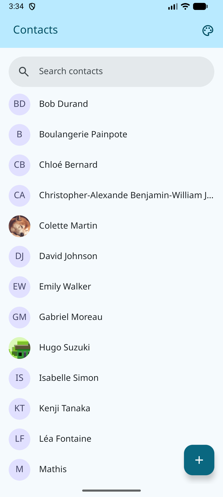
  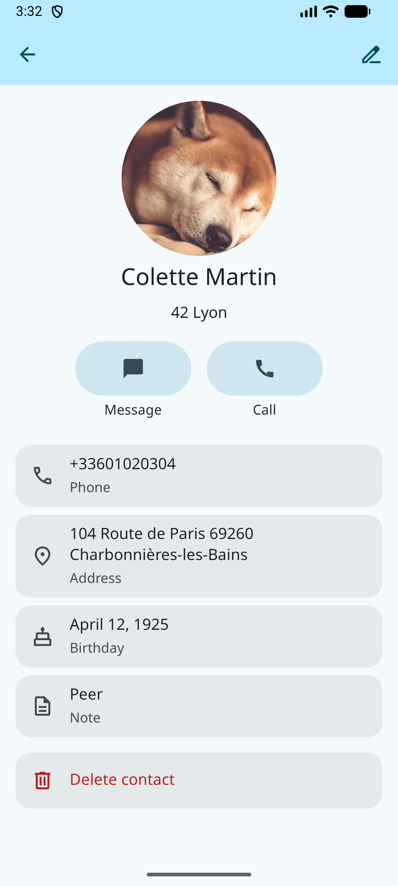
  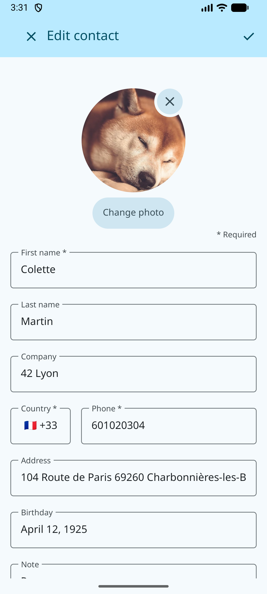
</p>

### Messaging

Each contact has its own conversation, sent and received through the device's SMS service. Messaging offers the following features:

- Users can send and receive SMS with their saved contacts.
- Each conversation keeps its full history, and older messages load as users scroll up.
- Users can tap a message to show its sender and the time it was sent.

<p align="center">
  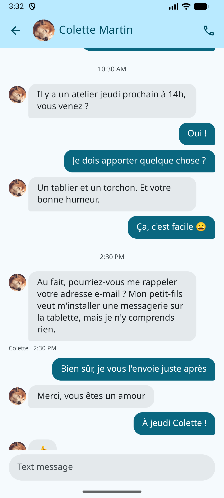
</p>

### Calls

Users can call a contact directly from the app, using the call button on the contact detail screen or in the conversation screen.

### Permissions

The app asks for each permission only when it is needed:

- The permission to receive SMS is requested when the app is first launched, so that incoming messages are saved even when the app is not open.
- The permission to send SMS is requested the first time users send a message.
- The permission to make phone calls is requested the first time users call a contact.

### Snackbar notifications

Short messages appear at the bottom of the screen to keep users informed without interrupting what they are doing.   
The app shows a snackbar in the following cases:

- When users return to the app, a snackbar shows the time the app was last sent to the background.
- When a message arrives while users are not in that contact's conversation.

### Multi-language support

English, French and Japanese, following the system language. Other languages fall back to English.

<p align="center">
  
  
  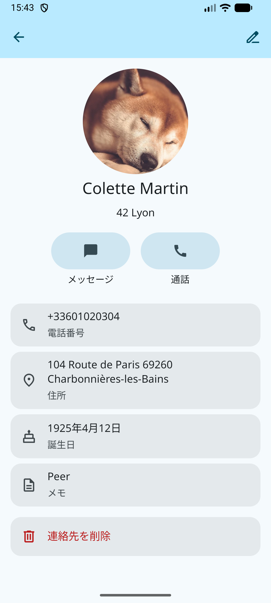
</p>

### UI

#### Color Theme

Change the header color from the palette menu: Ocean, Amber, Forest, Rose or Lavender. The choice is kept after the app restarts. Each theme also has a dark version.

<p align="center">
  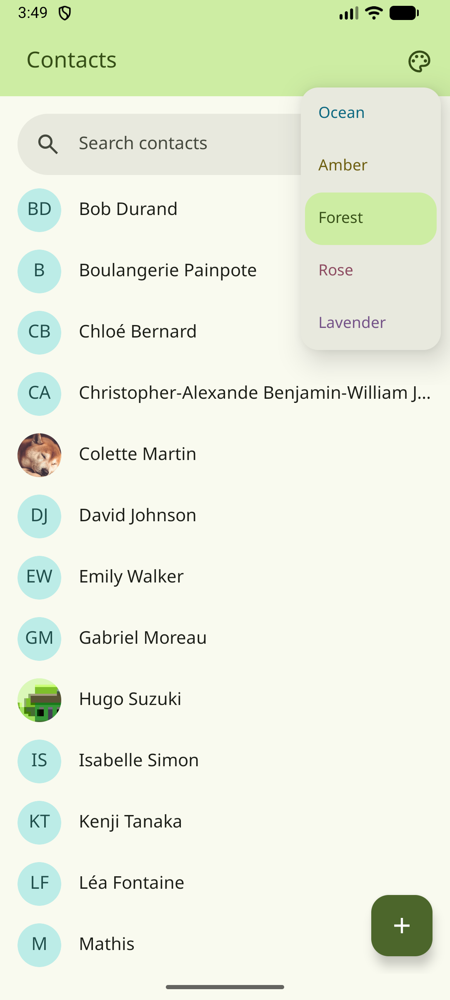
  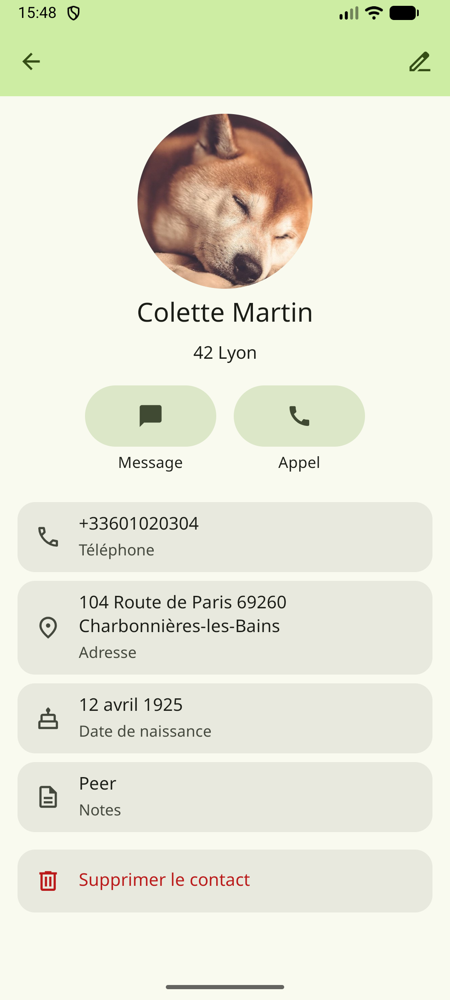
  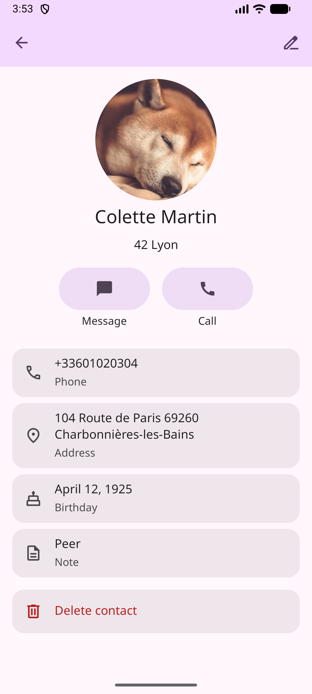
</p>

#### Dark mode

The app follows the system's dark mode setting. Each of the five themes has its own dark color palette, so the selected theme stays recognizable in both light and dark mode.

<p align="center">
  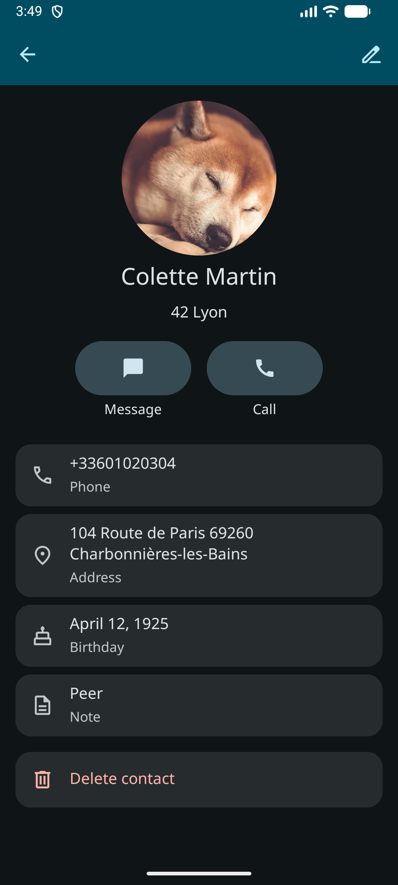
  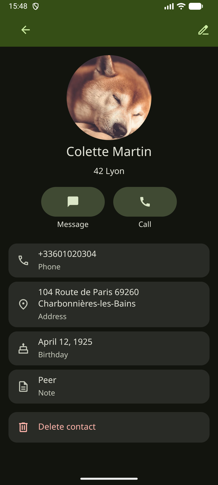
</p>

#### Vertical/Horizontal layout

Both orientations are supported. The current screen and unsaved form input are kept when the device rotates.

#### Material Design 3

Built with Android framework views only. Colors, typography, shapes and components follow Material Design 3.   
See [docs/MATERIAL_DESIGN_3.md](docs/MATERIAL_DESIGN_3.md) for the rules applied in the app.

## Architecture

`MainActivity` is the entry point of the app: Android launches it when users open the app. The rest of the code is split into three layers.

- **UI layer**: `MainActivity` starts the `Navigator`, which shows the screens (contact list, contact detail, contact form, conversation) under the top app bar and shows snackbars when needed. Each screen gets its data through a ViewModel.
- **Data layer**: Repositories read and write contacts and messages in SQLite through `DatabaseHelper`, on a background thread so the UI never waits for the database. Profile pictures are stored as files by `PhotoStorage`.
- **Telephony layer**: `SmsSender` sends messages and `Call` starts calls in the system Phone app. `SmsReceiver` picks up incoming SMS from the system and saves them through the repositories, even when the app is not open.

<p align="center">
  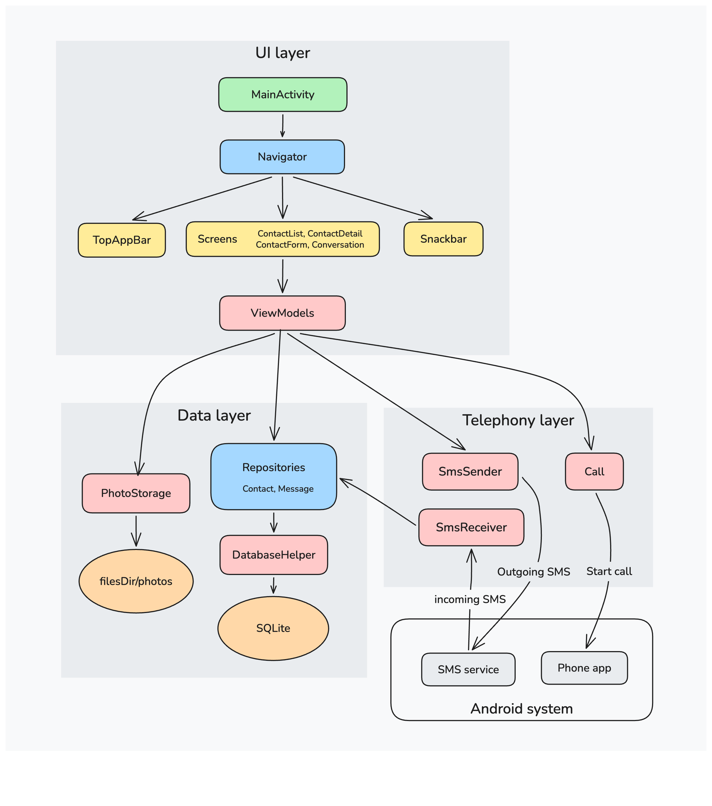
</p>

For more details, see [docs/NAVIGATION.md](docs/NAVIGATION.md) for how screens are switched, and [docs/DATABASE.md](docs/DATABASE.md) for the database.

## Project Structure

```
├── app
│   ├── build.gradle.kts
│   └── src
│       └── main
│           ├── AndroidManifest.xml
│           ├── java/com/ysengoku/ft_hangouts
│           │    ├── MainActivity.kt
│           │    ├── navigation/
│           │    ├── data
│           │    │   ├── model/
│           │    │   ├── repository/
│           │    │   ├── CursorExtensions.kt
│           │    │   ├── DatabaseHelper.kt
│           │    │   ├── PhotoStorage.kt
│           │    │   └── BackgroundTimeStore.kt
│           │    ├── ui
│           │    │   ├── Screen.kt
│           │    │   ├── contacts/
│           │    │   ├── conversation/
│           │    │   ├── components/
│           │    │   ├── ContextExtensions.kt
│           │    │   ├── format/
│           │    │   └── theme/
│           │    ├── telephony/
│           │    └── util
│           └── res
│               ├── drawable/
│               ├── font/
│               ├── layout/
│               ├── values/
│               ├── values-fr/
│               ├── values-ja/
│               └── values-night/
├── gradle/
├── gradlew
├── tools/
├── docs/
└── README.md
```

## Tech Stack

**Languages:**   

<div>   
  
</div>
<br />

**Frameworks & Libraries:**   
<div>
  
</div>
<em>Android framework APIs only, no external libraries</em>
<br />
<br />

**Database:**   

<div>
  
</div>
<br />

**Tools:**   
<div>
  
  
  
  
</div>

## Technical Restrictions

The app uses only the Android SDK and the Kotlin standard library. No external libraries are allowed, so features such as the database layer, navigation and UI components are implemented directly on top of framework APIs.

## Getting Started

### Prerequisites

- #### JDK 17 or later (required by the Android Gradle Plugin 9)
   ```bash
   # Linux
   sudo apt install openjdk-17-jdk

   # MacOS
   brew install --cask temurin@17
   ```

- #### Android SDK with platform 37, platform-tools and the emulator   
   download "Command line tools only" from
[developer.android.com/studio](https://developer.android.com/studio#command-line-tools-only), then:
   ```bash
   # Linux
   export ANDROID_HOME=~/Android/sdk
   # macOS
   export ANDROID_HOME=~/Library/Android/sdk

   mkdir -p $ANDROID_HOME/cmdline-tools
   unzip commandlinetools-*_latest.zip -d $ANDROID_HOME/cmdline-tools
   mv $ANDROID_HOME/cmdline-tools/cmdline-tools $ANDROID_HOME/cmdline-tools/latest

   export PATH=$PATH:$ANDROID_HOME/cmdline-tools/latest/bin:$ANDROID_HOME/platform-tools:$ANDROID_HOME/emulator
   ```
   Add the `export` line to `~/.zshrc` or `~/.bashrc`.

- #### SDK packages and system image
   ```bash
   # Linux, Intel Mac
   IMAGE="system-images;android-37;google_apis;x86_64"
   # Apple Silicon Mac  
   IMAGE="system-images;android-37;google_apis;arm64-v8a"     

   sdkmanager "platform-tools" "platforms;android-37" "emulator" "$IMAGE"
   ```

- #### An emulator on API 33 or later, using a **Google APIs** image (not Google Play): it includes `sqlite3`, which `tools/seed.sh` needs
   ```bash
   avdmanager create avd -n <avd_name> -k "$IMAGE" -d medium_phone
   ```
   Then set `hw.keyboard=yes` in `~/.android/avd/<avd_name>.avd/config.ini` to type with your computer's keyboard.

<br/> 
   
- *Android Studio is optional*
- *For the 42 Lyon cluster with limited disk quota, use [42-android-setup](https://github.com/ysengoku/42-android-setup) to install the SDK/Gradle cache under `/goinfre` instead of the default paths. It also creates the two emulators.*

### Usage

**Build the debug APK:**   
```bash
./gradlew assembleDebug
```

**Run on a medium_phone size emulator:**   
```bash
emulator -avd <avd_name> &
adb wait-for-device
./gradlew installDebug

# Or [Run ▶] in Android Studio
```

> [!NOTE]
> `./gradlew` is the Gradle Wrapper, included in the repo. It runs the Gradle version set in `gradle/wrapper/gradle-wrapper.properties`, so every machine and the CI build with the same version, and Gradle doesn't need to be installed.

*To test sending and receiving SMS, the emulators need a modem port. See [docs/SMS_TESTING.md](docs/SMS_TESTING.md).*

## Development

### Useful commands

**Lauch an emulator with specific modem port**
```bash
emulator -avd <avd_name> -port <emulator_port> -modem-simulator-port <modem_port> &
# e.g. emulator -avd phone_1 -port 5554 -modem-simulator-port 6520 &
```

**Launch the app**
```bash
adb -s emulator-<emulator_port> shell am start -n com.ysengoku.ft_hangouts/.MainActivity

# e.g.
# adb -s emulator-5554 shell am start -n com.ysengoku.ft_hangouts/.MainActivity
```

**Show logs**
```bash
adb -s emulator-<emulator_port> logcat --pid=$(adb -s -s emulator-<emulator_port> shell pidof com.ysengoku.ft_hangouts)
```

**Lint**
```bash
./gradlew lint

# report in app/build/reports/
```

**Check Kotlin style with [ktlint](https://pinterest.github.io/ktlint/)**   
CI runs ktlint 1.8.0 on every push and pull request to `main`.
```bash
# macOS
brew install ktlint
# Linux
curl -sSL -o ktlint https://github.com/pinterest/ktlint/releases/download/1.8.0/ktlint && chmod +x ktlint

ktlint "app/src/**/*.kt"
```

**Free Gradle's memory**
```bash
./gradlew --stop
```

### Tools

Helper scripts in `tools/`, run from the project root:

| Script | Description |
|---|---|
| `tools/emulators.sh` | Starts `phone_1` (`emulator-5554`, number `6520`) and `phone_2` (`emulator-5556`, number `6521`) with a modem port, then installs the app. |
| `tools/seed.sh` | Fills the database with demo contacts and messages from `tools/seed.sql`. Runs on `emulator-5554` by default, or on the emulator given as argument (`./tools/seed.sh emulator-5556`). Launch the app once before so the database exists. |
| `tools/extract_country_codes.py` | Generates `res/values/country_codes.xml` from libphonenumber's `PhoneNumberMetadata.xml`. Usage is in the script header. |

See [docs/SMS_TESTING.md](docs/SMS_TESTING.md) for testing SMS with these scripts.

### Testing

## Documentation

| Document | Content |
|---|---|
| [NAVIGATION.md](docs/NAVIGATION.md) | How `Navigator` switches screens inside `MainActivity` |
| [DATABASE.md](docs/DATABASE.md) | Schema, data flow, versioning, seeding and inspecting the database |
| [CONTACT_FORM.md](docs/CONTACT_FORM.md) | Contact form modes and input checks |
| [MATERIAL_DESIGN_3.md](docs/MATERIAL_DESIGN_3.md) | Material Design 3 rules applied in the app |
| [SMS_TESTING.md](docs/SMS_TESTING.md) | Testing SMS on emulators, and why the emulator does not relay SMS |

## Resources

- [Android Developer APP Architecture - App resources overview](https://developer.android.com/guide/topics/resources/providing-resources?hl=ja)
- [Android Developer API Reference - android.widget](https://developer.android.com/reference/android/widget/package-summary)
- [Android Developer API Reference - View](https://developer.android.com/reference/android/view/View)
- [Android Developer API Reference - R.attr](https://developer.android.com/reference/android/R.attr)
- [Android Developer - Drawable resources](https://developer.android.com/guide/topics/resources/drawable-resource?hl=ja)
- [Kotlin docs](https://kotlinlang.org/docs/home.html)

- [Material Design 3](https://m3.material.io)

- [libphonenumber - PhoneNumberMetadata.xml](https://github.com/google/libphonenumber/blob/master/resources/PhoneNumberMetadata.xml) (Apache License 2.0): source of the country calling codes in `country_codes.xml`

## Authors

<div valign="top">
  
  &nbsp Yuko SENGOKU &nbsp&nbsp (<a href="https://github.com/ysengoku">GitHub @ysengoku</a>)
</div>

## License

This project is for educational purposes.
