# Material Design 3

This document lists the Material Design 3 (M3) rules applied in ft_hangouts.

The project uses no external libraries, so Material Components is not available. M3 is reproduced by hand with framework widgets, the `Theme.Material` base theme and custom theme attributes. When adding new UI, follow the values below instead of the framework defaults.

## Table of Contents

1. [Color Roles](#color-roles)
2. [Typography](#typography)
3. [Dimensions](#dimensions)
4. [Components](#components)
   1. [Top App Bar](#top-app-bar)
   2. [Icon Button](#icon-button)
   3. [Search Bar](#search-bar)
   4. [Text Field](#text-field)
   5. [List Item](#list-item)
   6. [Avatar](#avatar)
   7. [Floating Action Button](#floating-action-button)
   8. [Menu](#menu)
   9. [Dialog and Bottom Sheet](#dialog-and-bottom-sheet)
   10. [Snackbar](#snackbar)
   11. [Message Bubble](#message-bubble)
5. [Resources](#resources)

## Color Roles

Framework roles are referenced with `?android:attr/` (`colorPrimary`, `colorBackground`, `colorError`). All other M3 roles are custom attributes declared in `res/values/attrs.xml` and referenced with `?attr/`.

`<theme>` is one of `ocean`, `amber`, `forest`, `rose` or `lavender`. Each theme was generated from one source color with [Material Theme Builder](https://material-foundation.github.io/material-theme-builder/):

<b>Ocean</b>  <code>#0A6780</code>

  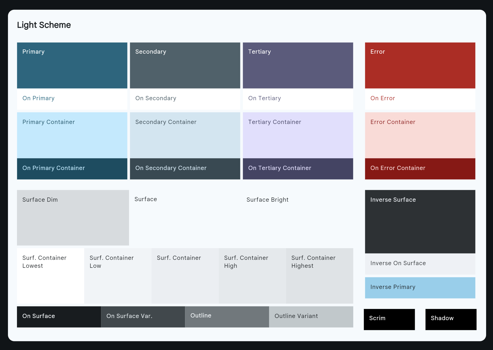
  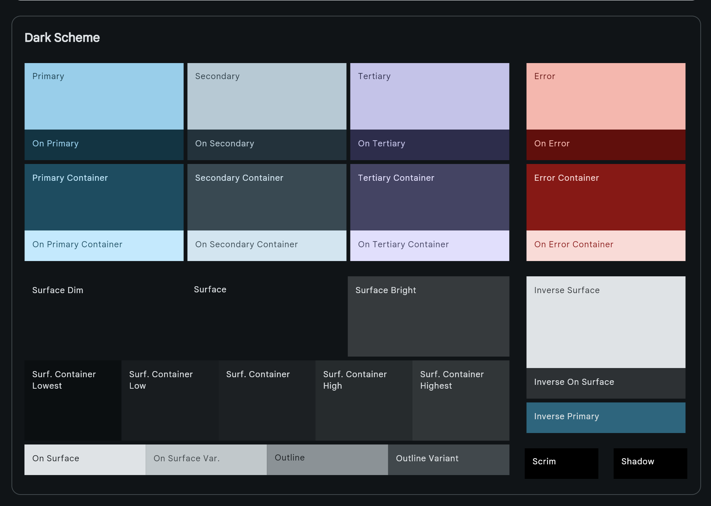

<b>Amber</b>  <code>#6D5E0F</code>

  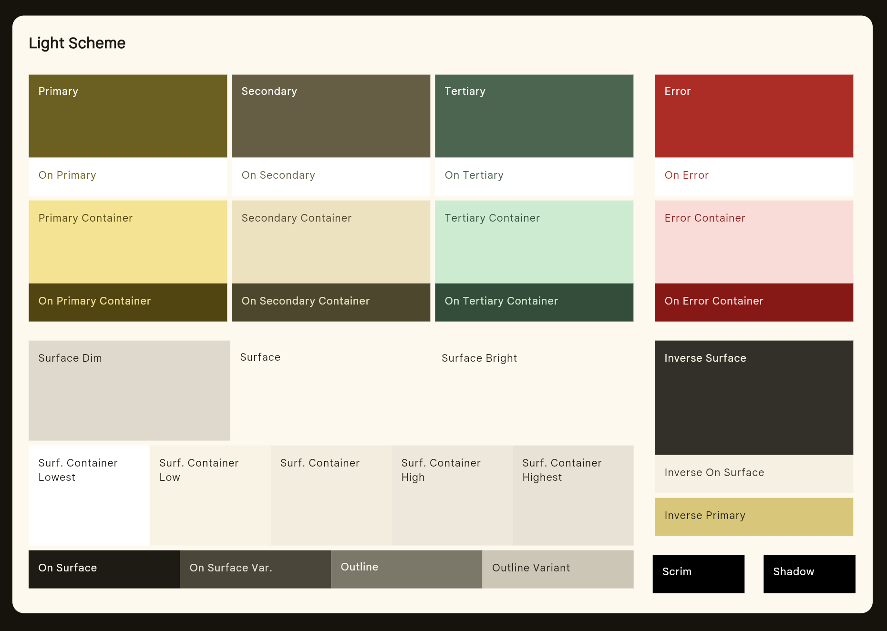
  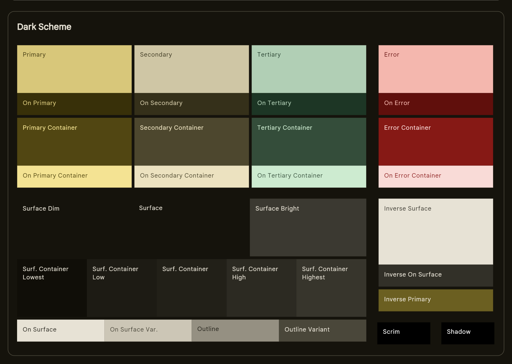

<b>Forest</b>  <code>#4C662B</code>

  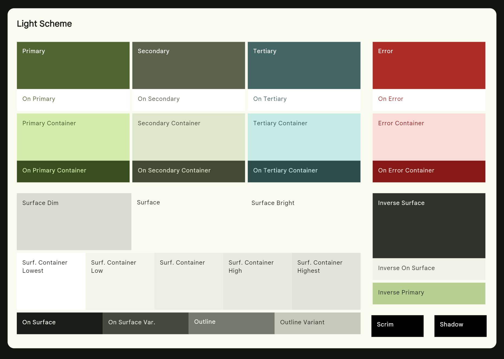
  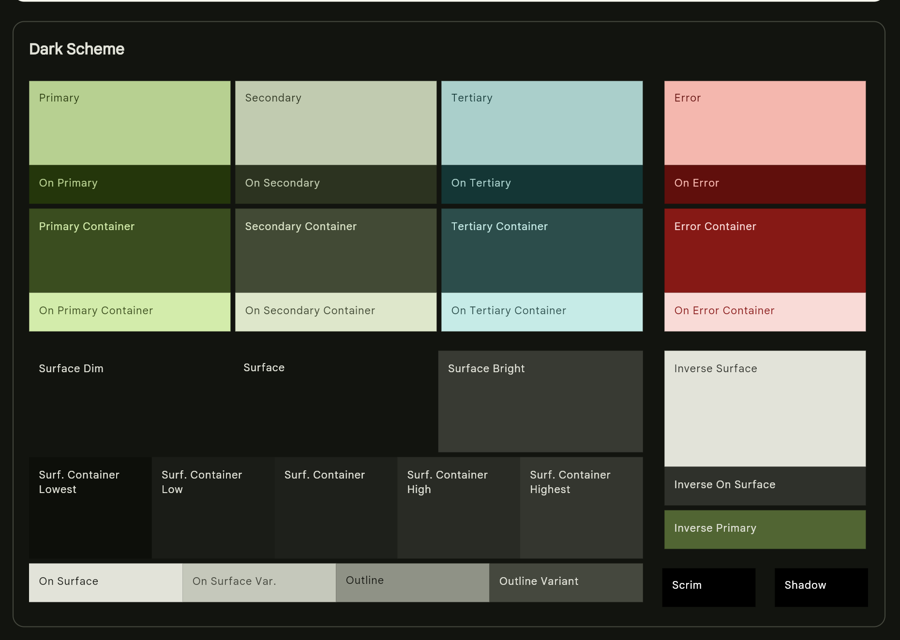

<b>Rose</b>  <code>#8C4A60</code>

  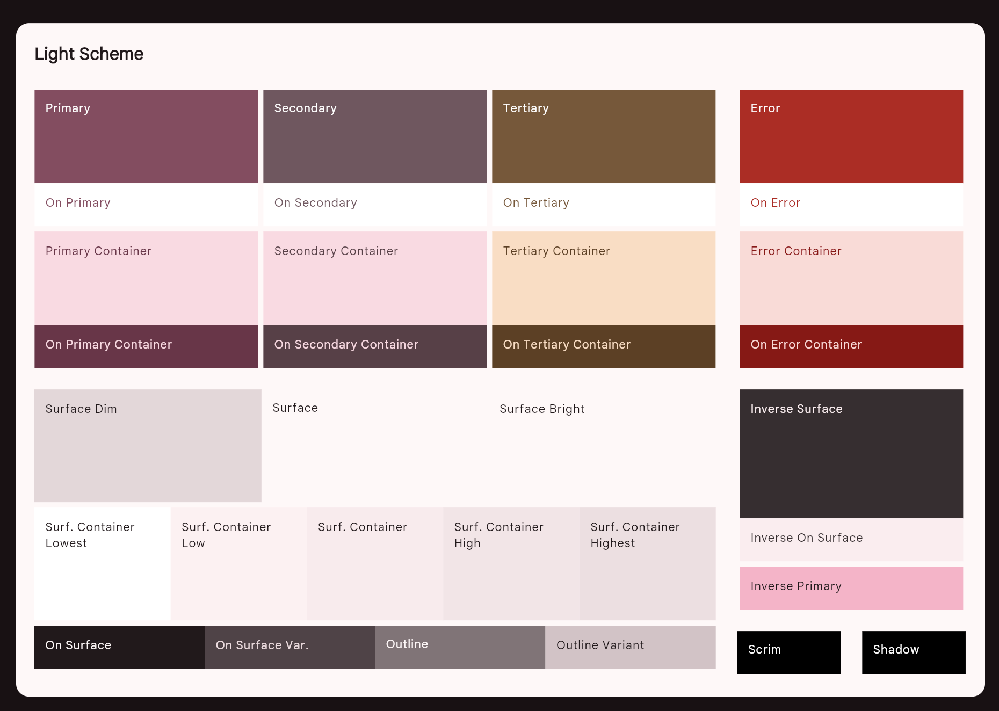
  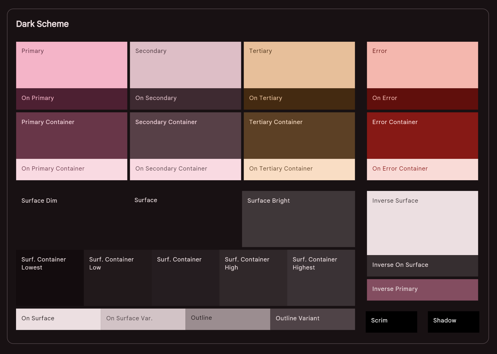

<b>Lavender</b>  <code>#735187</code>

  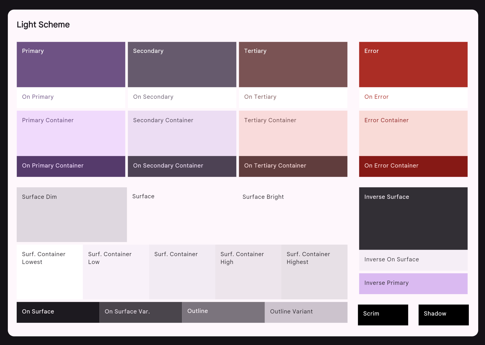
  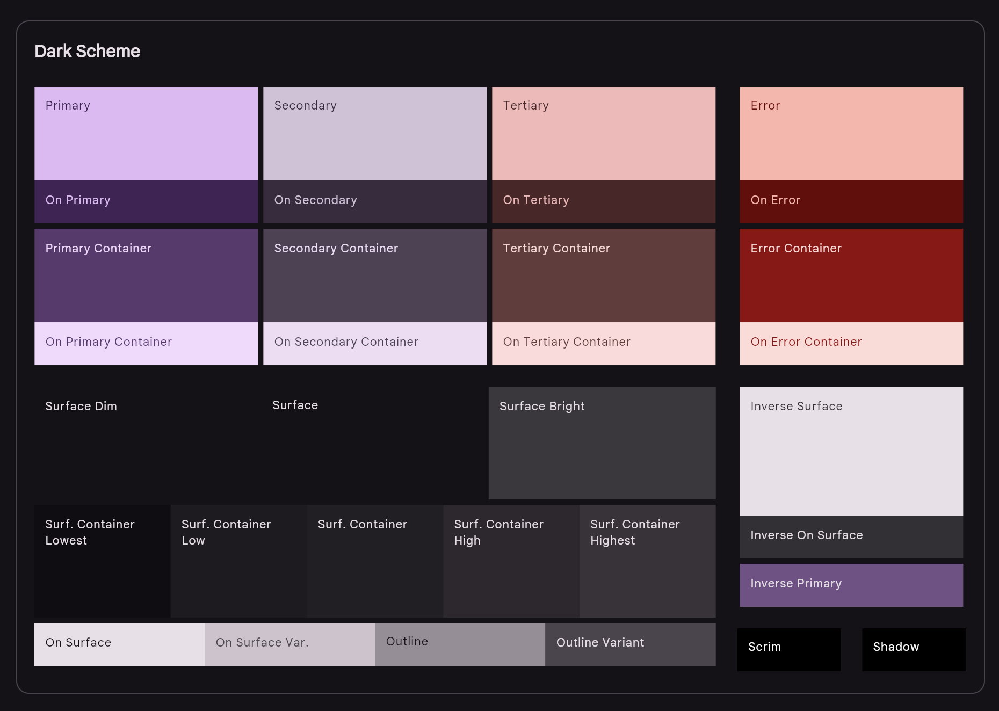

 

Each color is defined twice with the same name (`<theme>_<role>`): the light scheme in `res/values/colors.xml` and the dark scheme in `res/values-night/colors.xml`. Android picks one of the two from the system dark mode setting, so the themes in `themes.xml` need no dark variant.

**Rules:**

1. Never hardcode a color. Always reference a theme attribute. Icon vectors keep the fill color they were exported with, so every icon must be tinted with a theme attribute, with `android:tint` on the view or from its style.
2. Set every custom attribute in all five themes, and define every color in both `colors.xml` files.
3. Pair each container color with its "on" color.
4. Do not use the top app bar color (`primaryContainer`) for content.

**Resources:**   
[M3 Color roles](https://m3.material.io/styles/color/roles)  

## Typography

The framework has no M3 type scale, so each M3 style used by the app is defined as `TextAppearance.FTHangouts.<M3 name in PascalCase>` in `res/values/themes.xml`, with the size and weight from the [M3 type scale](https://m3.material.io/styles/typography/type-scale-tokens). Only the styles in use are defined.

`@font/noto_sans` is a font family with Noto Sans from weight 300 to 700, and the base theme sets it as the app font. Medium styles (Title Medium and the Label styles) use `@font/noto_sans_medium` directly, and Title Large uses `@font/noto_sans_display_regular`. Noto Sans has no Japanese glyphs, so Japanese text falls back to the system font, which is Noto Sans CJK on most devices.

**Rules:**

1. Set text styles with `android:textAppearance`, never `android:textSize` or `android:fontFamily` on a view.
2. Keep color out of TextAppearance styles. Set `android:textColor` on the view.
3. Add a new style only when it is used, with the values from the M3 type scale.

## Dimensions

Sizes and spacing are defined in `res/values/dimens.xml`, on the M3 4dp grid. Spacing is a shared scale:

| Resource | Value |
|---|---|
| `spacing_extra_small` | 4dp |
| `spacing_small` | 8dp |
| `spacing_medium` | 16dp |
| `spacing_large` | 24dp |

Component sizes are in `dimens.xml`. Their values come from the **Specs** tab of each component on [m3.material.io](https://m3.material.io/components):

| Component | Resources | M3 specs |
|---|---|---|
| Top app bar | `top_app_bar_*` | [App bars](https://m3.material.io/components/app-bars/specs) |
| Icon button | `icon_button_*` | [Icon buttons](https://m3.material.io/components/icon-buttons/specs) |
| Tonal button, tonal icon button | `tonal_button_*`, `tonal_icon_button_*` | [Buttons](https://m3.material.io/components/buttons/specs) |
| Search bar | `search_bar_*` | [Search](https://m3.material.io/components/search/specs) |
| Text field | `text_field_*` | [Text fields](https://m3.material.io/components/text-fields/specs) |
| List item | `list_item_*` | [Lists](https://m3.material.io/components/lists/specs) |
| Menu | `menu_item_*` | [Menus](https://m3.material.io/components/menus/specs) |
| Dialog, bottom sheet | `dialog_*` | [Dialogs](https://m3.material.io/components/dialogs/specs), [Bottom sheets](https://m3.material.io/components/bottom-sheets/specs) |
| Snackbar | `snackbar_*` | [Snackbar](https://m3.material.io/components/snackbar/specs) |
| FAB | `fab_*` | [Floating action button](https://m3.material.io/components/floating-action-button/specs) |

The detail fields on the contact detail screen have no resource of their own. They reuse `menu_item_corner_radius` (16dp).

M3 has no avatar or message bubble component. Their sizes (`avatar_*`, `message_*`) are app decisions.

**Rules:**

1. Padding and margins use the spacing scale. Add a new step only when no existing one fits.
2. Component sizes use component names (`<component>_<property>`), because they come from that component's M3 spec.
3. A value used only once may stay inline, unless it is an M3 spec value.
4. Text sizes are not dimensions. They belong to TextAppearance styles.

## Components

Values live in the layouts and `dimens.xml`. This section only records decisions that the code does not explain.

### Top App Bar

The background is `primaryContainer` instead of the M3 default `surface`, because the subject requires a menu that changes the header color and `surface` barely changes between themes. For the same reason, status bar icons are drawn dark in light mode (`@bool/light_system_bars`): `Theme.Material.Light` draws them white, which is unreadable on this background. In dark mode, `primaryContainer` is dark, so the icons stay white.

The bar extends behind the status bar. `MainActivity` adds the system bar and display cutout insets to its padding (top, and left and right in landscape) and the top inset to its height, so the content keeps its 64dp.

  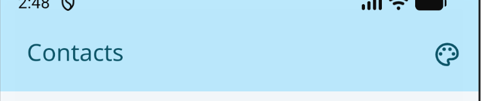

### Icon Button

Icons must be 24dp. The framework `ImageButton` style uses `scaleType="center"`, so a larger vector is drawn at its own size and overflows the padding.

  
  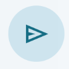

### Search Bar

The search bar is a pill (`search_bar_corner_radius`, 28dp) on `surfaceContainerHigh` (`bg_pill_input`). The message input in the conversation screen uses the same background. The search field in the country picker uses `bg_pill_input_dialog`, on `surface`, because the bottom sheet behind it is already `surfaceContainerHigh`.

  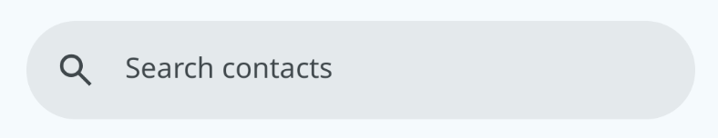

### Text Field

The contact form uses the M3 outlined text field: an `EditText` with a label `TextView` placed over its border. The border is 1dp `outline` by default, 2dp `primary` when focused and 2dp `colorError` when the input is invalid. The framework has no error state, so the error border is drawn with `state_activated`.

  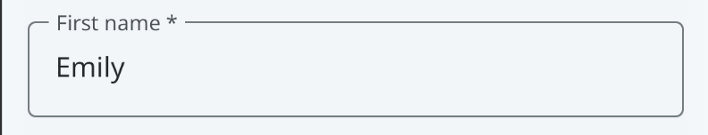

### List Item

First and last name share one `TextView`, because that is the only way to ellipsize a long name. There are no dividers, since M3 separates list items with spacing rather than lines.

  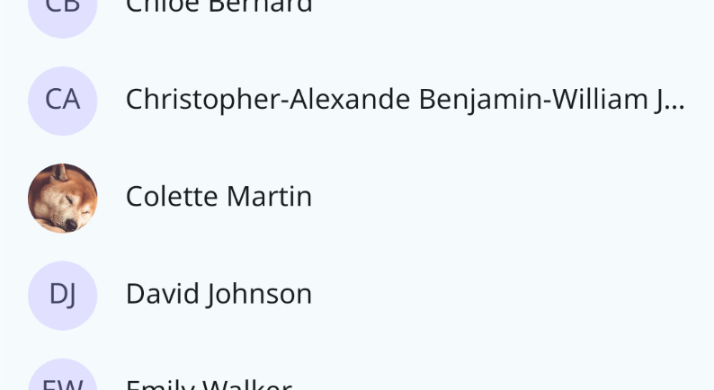

### Avatar

The background is `tertiaryContainer`, which keeps the avatar distinct from the top app bar (`primaryContainer`) and from tonal buttons (`secondaryContainer`). The photo is clipped to the circle with `setClipToOutline`, since the framework has no circular image view.

On the contact form, the button that changes the picture sits on the avatar's edge. Its 4dp border (`avatar_badge_outline`) uses the background color, so it looks cut out of the avatar.

  
  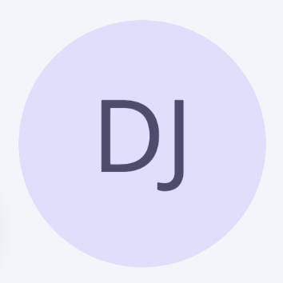
  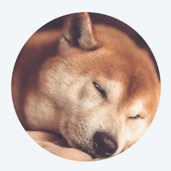

### Floating Action Button

The container is `primary` rather than the M3 default `primaryContainer`, which would blend with the top app bar. The list has 88dp of bottom padding with `clipToPadding="false"`, so the FAB never covers the last item.

  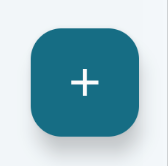

### Menu

The theme menu uses `surfaceContainerHigh`. The selected theme is highlighted with `primaryContainer`, the color of the top app bar, so users can see which header color is active.

### Dialog and Bottom Sheet

Dialogs and the country picker bottom sheet use `surfaceContainerHigh` with 28dp corners (`dialog_corner_radius`). The bottom sheet has rounded top corners only. Framework dialogs get these values from `ThemeOverlay.FTHangouts.Dialog` and `ThemeOverlay.FTHangouts.DatePickerDialog`.

  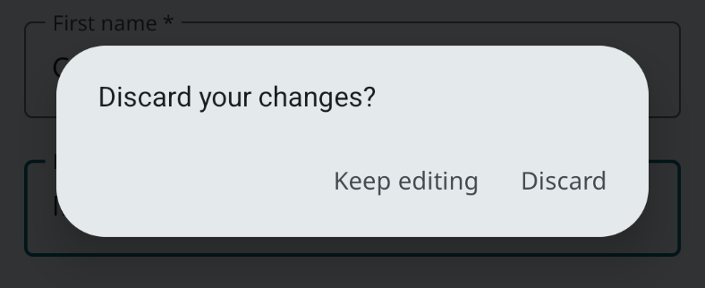
  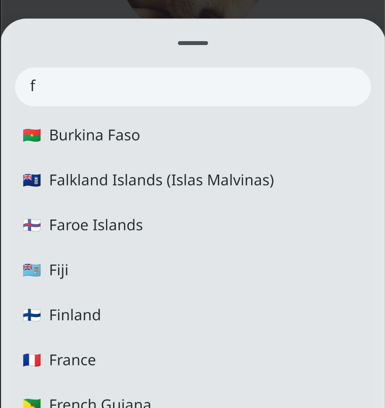

### Snackbar

The framework has no snackbar, so `Snackbar.kt` shows a custom view at the bottom of the screen. The colors are `inverseSurface` and `inverseOnSurface`, as in M3, so the snackbar stands out from the content in both light and dark mode. These two roles exist only for the snackbar.

  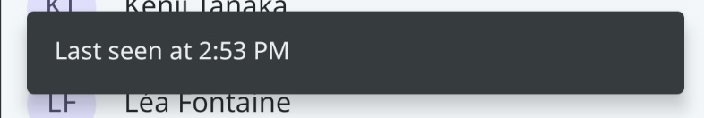

### Message Bubble

Sent messages use `primary` and received messages use `surfaceContainerHigh`. The corner on the sender's side at the bottom is smaller (`message_bubble_corner_radius_small`, 4dp), so each bubble points to its sender.

  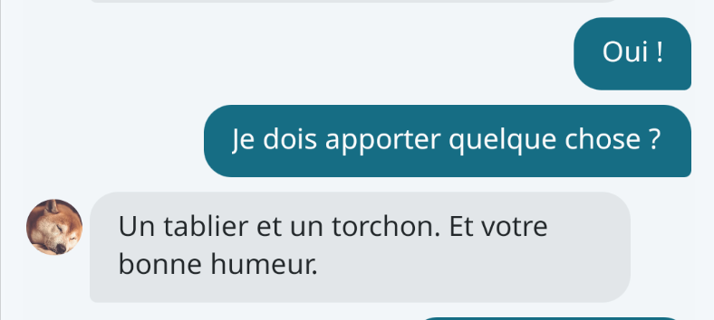

## Resources
 
[Material Theme Builder](https://material-foundation.github.io/material-theme-builder/)   
[Android Developer API Reference: View.setClipToOutline](https://developer.android.com/reference/android/view/View#setClipToOutline(boolean))
